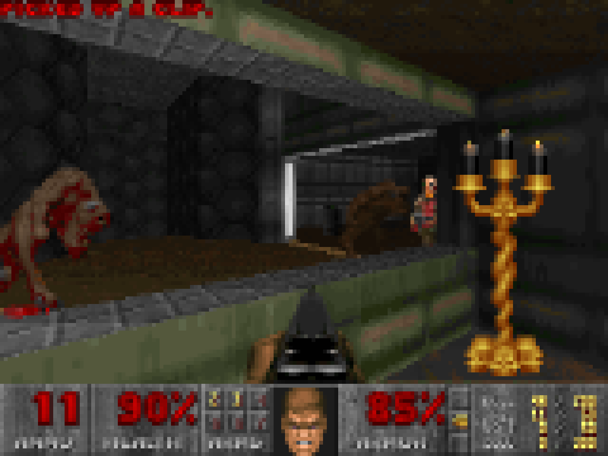
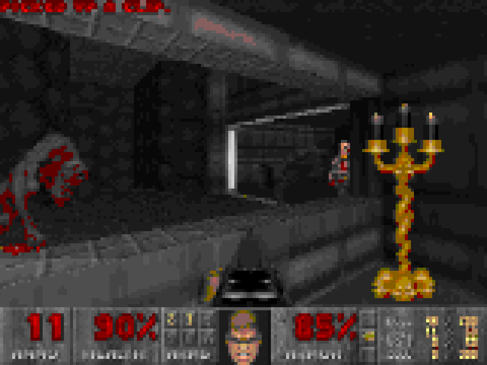
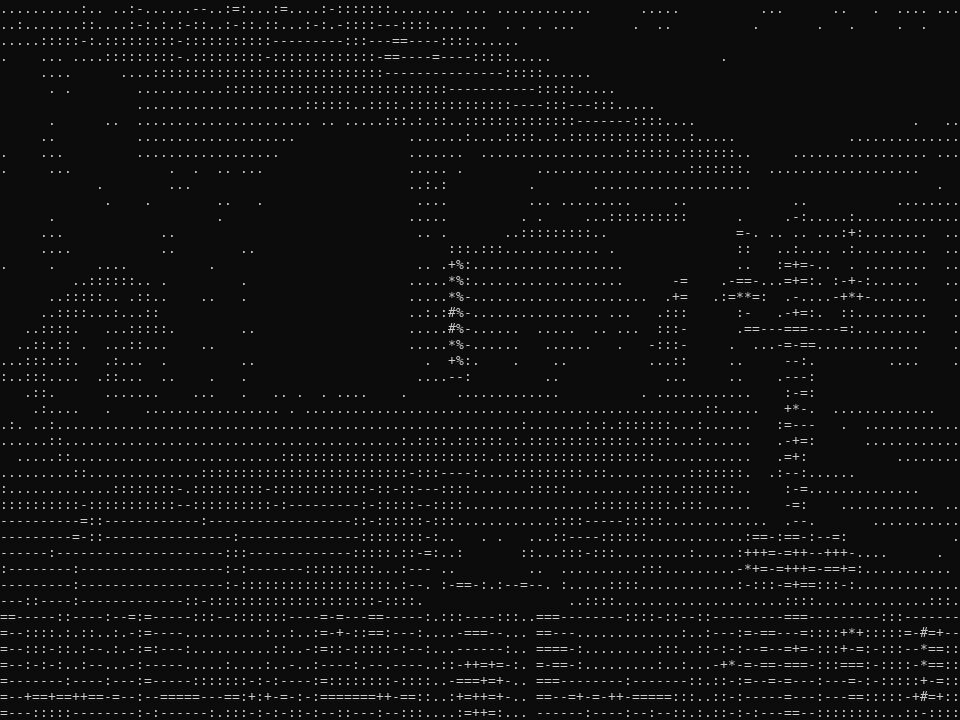

# doom-riscv-baremetal

[doomgeneric](https://github.com/ozkl/doomgeneric) built as a bare-metal RV64GC
program: no OS, no firmware, no display. It boots in machine mode, plays back
the demo recorded in the shareware WAD (`-timedemo demo1`), prints the result
on the UART, and powers the machine off.



The same demo frame in the three terminal output modes (`truecolor` above,
160x60 cells; `palette256` and `ascii` below). Captured from QEMU virt with
`-playdemo demo1` on the virtual clock, frame 2,500, and drawn as a terminal
shows it (8x16-pixel cells):

| `palette256` (xterm 256 colours, 160x60 cells) | `ascii` (120x45 cells) |
|---|---|
|  |  |

DOOM's browns and greens fall between the 256-colour cube levels, so that mode
looks greyer than truecolor.

## Requirements

- `riscv64-unknown-elf-gcc` (tested with 15.1.0) and the newlib source tree it
  was built from (`NEWLIB_SOURCE_DIRECTORY`, default
  `~/tools/riscv-gnu-toolchain/newlib`), see "Toolchain note" below
- `qemu-system-riscv64` (tested with 10.1.2) for the run targets
- `curl` and `sha1sum` for the WAD download

## Quick start

```sh
git clone --recursive https://github.com/SweetWeeds/doom-riscv-baremetal.git
cd doom-riscv-baremetal
make                 # build/qemu-virt/headless/doom-riscv64.elf (+ .bin)
make run             # run on QEMU virt
make run-ascii       # timedemo + every 35th frame as ASCII text (terminal-sized)
make run-color       # watch the demo at real speed in 24-bit colour, filling the terminal
make run-color-256   # same, for terminals without 24-bit colour
make deterministic   # build/qemu-virt/deterministic/doom-riscv64.elf, see below
```

Already cloned without `--recursive`? Run `git submodule update --init`.

The shareware `doom1.wad` is not in the repository (id Software allows it to
be redistributed only as the complete shareware package). The first `make`
downloads it to `wad/doom1.wad` and refuses it unless the SHA-1 matches v1.9
(`make wad` does only this step). To use your own copy, put it there or pass
`WAD_FILE=/path/to/doom1.wad`; another mirror: `SHAREWARE_WAD_URL=...`.

Expected output, end of `make run`:

```
[baremetal] timed 5026 gametics in 394 realtics (446.472076 fps)
[baremetal] frames drawn: 5065
```

QEMU exits with status 0 when the timedemo finishes and 1 on a DOOM error
(checked with a missing WAD: `I_Error: IWAD file 'missing.wad' not found!`).
A CPU trap prints `mcause`/`mepc`/`mtval` and exits with 3; that path has not
been triggered yet.

## Build variants

| Target | Clock DOOM sees | Frame output | Use for |
|---|---|---|---|
| `make` | hardware timer (CLINT `mtime`) | none | fps on QEMU or real hardware |
| `make run-ascii` | hardware timer | ASCII every 35 frames, appended | checking by eye that it renders |
| `make run-color` | hardware timer | every frame, 24-bit colour, redrawn in place | watching it (`-playdemo`, real speed, ~2.5 min) |
| `make run-color-256` | hardware timer | every frame, xterm 256 colours | same, older terminals |
| `make deterministic` | virtual counter | none | CPU simulators: instruction count independent of core speed |

Why the deterministic variant exists: some DOOM loops (the screen-wipe
transition, for example) spin until the clock changes, so with a real clock
the instruction count depends on core speed. The deterministic image contains
no hardware-timer reads at all (checked with `nm`).

Retired instructions counted with QEMU's `libbb.so` TCG plugin, QEMU 10.1.2
virt, same ELF per column:

| Run | `make` (hardware timer) [instr] | `make deterministic` (virtual clock) [instr] |
|---|---|---|
| 1 | 16,024,243,284 | 15,966,014,971 |
| 2 | 16,024,602,351 | 15,966,014,971 |
| 3 | 16,029,034,983 | – |

(Hardware-timer runs measured before the colour renderer was added; the
deterministic count was re-measured after it, twice, identical.)

Both play 5,026 gametics (game logic steps, 35 per game second) and draw
5,065 frames. In the deterministic build the printed "realtics"/fps are
meaningless; measure cycles in the simulator.

Remaining timing dependence: `platformConsoleWriteCharacter` polls the UART
"transmit empty" bit. QEMU never makes it wait, but on a real 16550 or an RTL
UART model the poll count depends on the UART-to-core speed ratio. Output is
about 60 lines in the headless builds, so this is small but not zero.

Other knobs (all `make VAR=value`):

- `DOOM_COMMAND_LINE` (default `doom -iwad doom1.wad -timedemo demo1 -nogui`)
- `FRAME_OUTPUT_INTERVAL` (0 = no frames, N = every Nth frame)
- `FRAME_RENDER_MODE` = `ascii` | `truecolor` | `palette256`
- `FRAME_COLUMN_COUNT` (0 = ask the terminal its size; falls back to 80 columns)
- `SHOULD_REDRAW_IN_PLACE` (1 = animate at the top-left instead of scrolling)
- `SHOULD_USE_SEMIHOSTING_CONSOLE` (1 = fast stdout through QEMU semihosting, see below)
- `PLATFORM_DEFINES` to retarget, e.g. `-DPLATFORM_UART_BASE_ADDRESS=0x...`
- `VARIANT_NAME` gives each configuration its own build directory.

## Terminal output

Colour modes print U+2580 "▀" in each cell: foreground colour = upper pixel,
background colour = lower pixel. Terminal cells are about 2:1 tall, so each
half is roughly square and one cell carries two pixels. The picture keeps
DOOM's 4:3 shape and is box-filtered down from 320x200; at most 320x200 is
used. Size comes from the terminal itself (cursor-position report after
moving the cursor to 999;999), so resize the terminal before starting.

Speed is limited by output bandwidth, not by DOOM. QEMU's 16550 model makes
one host write per byte (`hw/char/serial.c`, `qemu_chr_fe_write(..., 1)`),
about 0.5 MB/s, while a 157x59-cell truecolor frame is ~240 KB. So the colour
targets send stdout through RISC-V semihosting instead, one host write per
16 KB block. Measured on a simulated 200x60 terminal (picture 157x59 cells),
30 s of `-playdemo`, all frames verified complete:

| Mode | Console path | Frame size [KB/frame] | Displayed rate [frame/s] |
|---|---|---|---|
| truecolor | 16550 UART | 235 | 2.3 |
| truecolor | semihosting | 244 | 17.4 |
| palette256 | semihosting | 110 | 34.8 (game runs at 35) |

The rate on a real terminal depends on how fast it parses escape sequences.
DOOM keeps real time either way; a slower terminal just shows fewer frames.
Semihosting only works under QEMU with `-semihosting-config enable=on,target=native`
(the run targets add it); on real hardware the `ebreak` sequence traps.

## Boards

Every target above takes `PLATFORM=...`; images go to
`build/<platform>/<variant>/`.

| `PLATFORM` | UART | Boot hart | Timer | How it stops |
|---|---|---|---|---|
| `qemu-virt` (default) | NS16550 at 0x1000_0000 | 0 | 10 MHz | `sifive,test` power-off device |
| `qemu-sifive-u` | SiFive UART at 0x1001_0000 | 1 | 1 MHz | semihosting `SYS_EXIT` |

`qemu-sifive-u` values come from the device tree QEMU's `sifive_u` machine
emits. Its hart 0 is `rv64imac` (no FPU), so DOOM runs on hart 1; it has no
power-off device, so it exits through semihosting (QEMU is started with
`-semihosting-config`, which the Makefile adds).

```sh
make PLATFORM=qemu-sifive-u run          # timedemo over the SiFive UART
make PLATFORM=qemu-sifive-u run-color    # colour, stdout via semihosting
```

Checked on `qemu-sifive-u`:

| Check | Result |
|---|---|
| timedemo over SiFive UART | `timed 5026 gametics in 386 realtics`, exit 0 |
| UART receive (terminal size reply) | `80 x 30 cells (terminal size)` |
| truecolor frames sent only over the SiFive UART, 30 s | 136 of 136 frames complete (2,400 cells each) |
| missing WAD | `I_Error: IWAD file 'missing.wad' not found!`, exit 1 |
| booting on hart 0 (no FPU) on purpose | `fatal trap: mcause=2 ... mtval=0x00305073` (`csrwi fcsr,0`), exit 3 |

Not checkable in QEMU: its SiFive UART model ignores the enable bits and the
baud divisor and sends at host speed, so the UART set-up and the real
115200 bps timing must be confirmed on hardware.

### SiFive UART notes

- Registers are 32-bit; `txdata` bit 31 = transmit FIFO full, `rxdata` bit 31
  = receive FIFO empty. `rxdata` is read once per byte because the read pops
  the FIFO.
- `platformInitializeConsole()` (called from `start.S` before anything can
  trap) enables transmit and receive and, if `PLATFORM_UART_INPUT_CLOCK_HZ` is
  non-zero, sets `div = clock / baud - 1` (rounded). With 0 it keeps the
  divisor the boot loader set.
- At 115200 bps 8N1 the line carries 11,520 B/s. Measured frame sizes give
  about 4.6 frame/s for 80x30 ASCII, 1.4 frame/s for 40x15-cell 256-colour,
  0.15 frame/s for 80x30-cell truecolor.

## Porting to another simulator or SoC

Everything board-specific is in `platform/platform_config.h`: RAM base and
size, stack size, boot hart, UART type/base/clock/baud, CLINT `mtime` address
and frequency, and the exit method (`PLATFORM_EXIT_METHOD`: power-off device,
semihosting, or halt in `wfi`). A new board is a new profile in the Makefile
or a set of `PLATFORM_DEFINES`; a `-DNAME=...` there replaces the profile's.

Memory needed: about 4.9 MB image (4.2 MB of it is the WAD) + 6 MiB DOOM zone
heap + 1 MiB stack. 16 MiB of RAM works (tested with
`PLATFORM_DEFINES=-DPLATFORM_RAM_SIZE_BYTES=0x01000000` and QEMU `-m 16M`).

Each set of options should get its own `VARIANT_NAME` if you want to keep
several images; changing options without one rebuilds that variant's
platform objects in place (tracked in `build_configuration.txt`).

## How it works

| File | Role |
|---|---|
| `platform/start.S` | reset entry: gp/sp, `mtvec`, enable FPU (`mstatus.FS`), clear bss, call `main` |
| `platform/linker_script.ld.in` | memory map, preprocessed with `platform_config.h` |
| `platform/platform_hardware.c` | NS16550 / SiFive UART, optional semihosting console, timer, exit, fatal trap report |
| `platform/system_calls.c` | newlib syscalls: stdout to UART, malloc heap, the embedded WAD served as a read-only file |
| `platform/wad_image.S` | `.incbin` of `wad/doom1.wad` |
| `platform/doomgeneric_baremetal.c` | doomgeneric callbacks, clean exit on timedemo |
| `platform/terminal_renderer.c` | terminal size query, ASCII / truecolor / 256-colour frame output |
| `platform/compiler_runtime.c` | medany `__clzdi2` (see below) |

Upstream doomgeneric is not modified; two behaviours are adjusted at link
time with `--wrap`:

- The timedemo ends via `I_Error("timed ...")` with status -1; the wrapper
  turns that one message into exit status 0.
- Upstream bug: `D_DoomMain()` passes its local array `demolumpname` to
  `G_DeferedPlayDemo()`/`G_TimeDemo()`, which keep the pointer. doomgeneric
  returns from `D_DoomMain()`, so the stack is reused and `-playdemo` failed
  at the end with `W_GetNumForName: <garbage> not found!`. The wrappers pass
  a static copy of the name instead.

### Toolchain note: code model

The prebuilt `riscv64-unknown-elf` newlib and libgcc in `/opt/riscv` are
compiled with `-mcmodel=medlow`, which cannot reach RAM at `0x8000_0000`.

- newlib: the first `make` (or `make newlib`) builds it with
  `-mcmodel=medany` into `build/newlib-medany` from
  `~/tools/riscv-gnu-toolchain/newlib` (a few minutes; checked from an empty
  build directory). `/opt/riscv` is not touched.
- libgcc: only `__clzdi2` referenced data out of range, so
  `platform/compiler_runtime.c` provides it.

## Provenance

- doomgeneric: `third_party/doomgeneric`, commit `e257a09` (GPL-2.0)
- doomgeneric is a git submodule pinned to that commit, unmodified.
- WAD: DOOM shareware v1.9 `doom1.wad`, 4,196,020 bytes,
  SHA-1 `5b2e249b9c5133ec987b3ea77596381dc0d6bc1d`; downloaded by `make`,
  not included.
- Toolchain: riscv64-unknown-elf-gcc 15.1.0, newlib 4.4.0 snapshot; QEMU 10.1.2

## License

GPL-2.0 (see `LICENSE`), the same as doomgeneric, which this code links
against. DOOM game data is not covered and is not distributed here.
